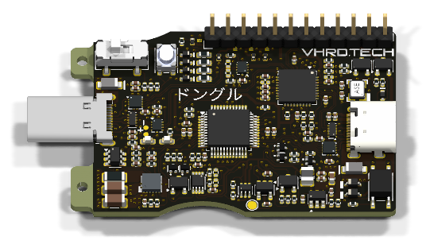

<h1 align="center">Portwright</h1>

  A USB-Type-C dongle with a <b>USB Hub</b>, <b>UART / I2C / GPIO / ADC</b>, a <b>power switch</b> and a <b>power meter</b>.

  Plus a fast, scriptable CLI (<code>portwright</code> / <code>pw</code>) to drive it all.

  

  <b><a href="https://vhrdtech.github.io/portwright/">Documentation</a></b> — quickstart, usage, scripting and design docs.

