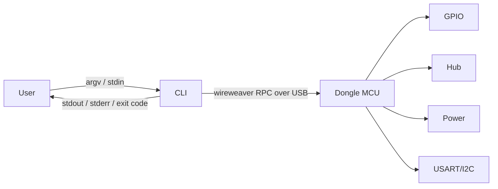

# CLI Design

This document describes the design of the **Donguru command-line interface**:
its goals, its command surface, how it is configured, and how it composes with
other Unix tools.

!!! info "Status"

    This is a **design document**: it is the spec of the full v1 command
    tree, including commands no release has yet. What is actually built and
    what still answers "not implemented" is tracked in
    [FEATURES.md](https://github.com/vhrdtech/typec_dongle/blob/main/FEATURES.md),
    not duplicated here.

## Goals

The CLI is the primary way a user interacts with a [Donguru](../../index.md)
dongle from a host computer. It must be:

- **Unix-native** — line-oriented, pipeable, and scriptable. It reads from
  arguments/stdin and writes results to stdout, diagnostics to stderr, and
  signals outcome through exit codes.
- **Easy to type and memorable** — short, consistent verbs. A short binary
  alias. Sensible defaults so the common case needs few flags.
- **Layered and predictable configuration** — defaults, config files, then
  environment, then command-line flags, each overriding the previous.
- **Cross-platform** — Linux is the priority target, followed by macOS, then
  Windows. Nothing in the design should hard-code Linux-only assumptions.
- **Extensible** — third parties can add subcommands without modifying the
  core, using a Git/Cargo-style discovery mechanism.

## Non-goals

- The CLI is **not** a daemon or a long-running service. Each invocation does
  one job and exits. (A `watch`/`monitor` mode may stream until interrupted,
  but it is still a single foreground process.)
- The CLI is **not** a GUI and makes no assumptions about a terminal being
  interactive. All behaviour must degrade cleanly when stdout is a pipe.

## What the CLI controls

The Donguru dongle exposes several subsystems. The CLI groups its commands to
match them:

| Subsystem        | Responsibility                                                               |
| ---------------- | ----------------------------------------------------------------------------|
| Device           | Enumerate and select dongles; the device contract (firmware, board, UID, user label, counters, stored log, last reset). |
| Power            | Plug and header VBUS, the power meter (V/I/P), data switch.                  |
| SBU / UART       | Who owns the plug SBU lines, SWD-host orientation, UART over SBU.           |
| GPIO / I2C / ADC | Read and drive general-purpose I/O, I2C buses, named ADC channels.          |
| USB Hub          | Inspect and recover the downstream USB hub.                                 |
| LEDs / input     | Power and status LED mode, the button and slide switch.                     |
| Firmware         | Report firmware version and update the dongle firmware.                     |
| Bring-up         | Raw pin, hub register and UCPD access for board bring-up (behind `debug`).   |

## Transport model

The host talks to the dongle over a **control channel exposed by the dongle's
MCU**. The channel is carried over USB, and the wire protocol is
[**WireWeaver**](https://github.com/vhrdtech/wire_weaver). The CLI treats this
as a typed request/response transport: each subcommand maps to one or more RPC
calls.



Design Notes:

- Commands are tested against an **in-process mock** instead of a hand-written transport trait (CORE-3,
  `donguru-core/src/mock/`): the generated `DonguruApi` server runs on WireWeaver's own `in_process` transport, so
  tests exercise the same host stack (link setup, version check, timeouts, observe) as the real USB link, with no
  parallel abstraction to keep in sync.
- Firmware update is exposed through the same front end even though its underlying mechanism (CLI-10, FW-12) isn't
  built yet. The user-facing command is stable regardless of how flashing is implemented.

## Many small tools behind a single front end

Like `git`, Donguru presents a **single, user-facing front end** while the
project itself is assembled from many small, targeted tools (binaries, scripts,
…) such as `donguru-gpio`, `donguru-update`, and so on.

The front-end binary that assembles the full subcommand tree is named
**`donguru`**, with a short alias **`dg`**. It is the single point of contact
for a regular user. Rationale:

- **One thing to install, discover (`donguru help`), and version.**
- **Shared behaviour lives in one place.** Configuration, device selection, and
  output formatting are implemented once in the front end instead of being
  duplicated in every tool.
- **A subcommand tree is familiar.** Tools like `git`, `cargo`, `docker`, and
  `ip` follow the same pattern, and it is easy to explore via `--help` at every
  level.

This approach keeps the *benefits* of separate, independently developed tools
while giving the user a single entry point. Because configuration loading and
layering is itself exposed as a command (see [Configuration](#configuration)),
both built-in commands and later-added **plugin** commands can reuse the same
mechanism.

### Naming

- **Canonical binary:** `donguru`.
- **Short alias:** `dg` (installed alongside, the same executable under two
  names).
- **Subcommands** are short, lowercase verbs and nouns. Prefer `noun verb`
  grouping where a subsystem has several actions (e.g. `gpio read`,
  `power on`), and a bare verb where there is only one obvious action.
- **Third-party extensions** are encouraged to add a two-letter namespace after
  the `donguru-` prefix to avoid future collisions with built-ins that do not
  exist yet — e.g. `donguru-vh-scan` is invoked as `donguru vh-scan`.

## Command tree

The following is the full v1 surface (design `prj/P2534-donguru/design/api-v1.md`), built up one piece at a time;
FEATURES.md's `CLI-*` ids say which of it exists today. `dg` is the short alias for `donguru`. Every command accepts
`--format text|json|jsonl`; a `watch`-style command polls at `--interval` until WireWeaver's observe lands on the
host side (CLT-28), then switches to observe with no change to its output.

```text
dg info                                   # contract summary: firmware, board/variant, uid, label, last reset (CLI-7)
dg device list | info | select            # enumeration, identity, pin a default device for this project (CLI-7)
dg device label [NAME] [--notes ..]       # the user_info name and free-text notes (CLI-19)
dg device log [--follow]                  # stored defmt log, decoded with the ELF found by its build id (CLI-19)
dg device counters [--watch]              # cnt counters, decoded with the ELF found by its build id (CLI-19)
dg device reset-cause [--clear]           # cause of the last reset, crash record if there is one (CLI-19)
dg power status                           # plug VBUS + header VBUS_SW + meter in one table (CLI-11)
dg power on|off [--allow-voltage 20V] [--trip 2A]
dg power cycle [--off 500ms] [--release-sbu]
dg power meter                            # one reading: V, I, P, T, totals
dg power watch [--interval 100ms|--on-change]
dg power totals [--reset]
dg usb status | connect | disconnect      # plug data switch (U701) (CLI-6)
dg header vbus on|off|status [--allow-voltage V]   # CLI-16 warning + confirmation above 5.5 V
dg header relay on|off|status
dg sbu status | release                   # who owns SBU, V_SBU, pull-ups (CLI-20)
dg sbu orientation [auto|normal|swapped]
dg uart open [--baud 115200 --parity none ..]   # terminal; stdin -> tx, rx -> stdout, works in pipes (CLI-20)
dg uart monitor                           # both SBU lines, tagged A / B
dg uart pty                               # a pty for tools that want a tty (picocom, pyserial)
dg uart break [--for 250ms]
dg i2c scan | read | write | transfer [--bus plug|header]   (CLI-12)
dg gpio read|write|mode|watch <pin>       # pins: io7..io10, sbu1, sbu2, a2, b2 (CLI-5)
dg adc read [CHANNEL..] [--raw]           # named channels (CLI-22)
dg input status | watch                   # button, switch, events (CLI-22)
dg hub status | recover                   # (CLI-22)
dg led mode all-off|essential|normal | brightness LEVEL | identify [5s]   (CLI-21)
dg swd status | mode | release(-> sbu release) | memtest   (CLI-17, CLI-18)
dg fw version | update                    # CLI-10
dg debug pin get|set|af NAME              # net names from hw_b153a.md: dg debug pin set RELAY_EN high (CLI-23)
dg debug pins [--boot] [--diff]           # dump, diff against the expected reset state
dg debug hub read|write REG
dg debug ucpd [1|2] [--role rd|rp1a5|off]
dg debug reg ADDR [N]
dg settings show | set KEY VALUE | reset [--factory]   # device.settings
dg udev generate | install | uninstall | status        # Linux udev rule (CLI-8)
dg config generate | show | path | validate             # layered configuration (CLI-9)
dg completions <shell>                    # shell completions (CLI-3)
dg top                                    # 💡 live dashboard of every observed level (CLI-24, idea)
```

## Global flags

These flags are accepted at every level of the tree and apply to all
subcommands. They are collected here so the individual command sections can stay
focused on their own arguments.

| Flag                    | Purpose                                                        |
| ----------------------- | -------------------------------------------------------------- |
| `-d, --device <sel>`    | Select the target dongle (see [Device selection](#device-selection)). |
| `-f, --format <fmt>`    | Output format: `text` (default), `json`, or `jsonl`.           |
| `--color <when>`        | Colour output: `auto` (default), `always`, or `never`.         |
| `-v, --verbose`         | Increase diagnostic detail on stderr (repeatable, e.g. `-vv`). |
| `-q, --quiet`           | Suppress non-essential stderr output.                          |
| `-h, --help`            | Show help for the current command.                             |
| `-V, --version`         | Print the `donguru` version and exit.                          |

## Unix-philosophy

The CLI is built to be a good citizen in pipelines.

- **stdout is data, stderr is diagnostics.** Only requested results go to
  stdout. Progress, warnings, and errors go to stderr, so `donguru … | jq`
  never sees log noise.
- **Exit codes are meaningful.** `0` success; non-zero on failure with distinct
  codes for categories (usage error, no device, device error, timeout), see
  [Exit codes](#exit-codes).
- **Output formats are selectable.** A global `--format`/`-f` flag chooses the
  representation:
    - `text` (default) — human-readable, aligned, possibly colourised when
      stdout is a TTY.
    - `json` — one JSON value, for machine consumption.
    - `jsonl` — newline-delimited JSON for streaming commands (`watch`).
- **No colour / no interactivity when piped.** Colour and progress spinners are
  auto-disabled when stdout is not a TTY, and can be forced with
  `--color=always|never`. Honour `NO_COLOR`.
- **Read from stdin where it composes.** Byte payloads (e.g. `i2c write`,
  `fw update -`) may be read from stdin so data can be piped in.
- **Quiet and verbose knobs.** `-q/--quiet` suppresses non-essential stderr;
  `-v/--verbose` (repeatable) increases diagnostic detail.

Example pipelines:

```bash
# Machine-readable power reading fed to jq
dg power meter -f json | jq .current_ma

# Stream GPIO changes into a log
dg gpio watch 3 -f jsonl >> gpio.log
```

## Configuration

Configuration is **layered**. Later layers override earlier ones on a per-key
basis: a lower-priority layer still provides any keys that a higher-priority
layer omits.

!!! note "Ideal three-state merge"

    Where the libraries make it practical, a richer merge that distinguishes
    three states per key — **None**, **Default**, and **Some(value)** — would be
    preferable. The rules would be:

    - A previous layer's **None** or **Default** can always be overwritten by
      the next layer.
    - If the current layer explicitly sets **None**, a **Default** or
      **Some(value)** from a previous layer takes precedence.
    - An explicit **Some(value)** in a higher layer always wins.

    Whether this is worth the added complexity depends on library support and
    is left open for implementation.

| Priority       | Layer                 | Source                                     |
| -------------- | --------------------- | ------------------------------------------ |
| 0 (lowest)     | Built-in defaults     | Compiled-in fallback values.               |
| 1              | Config file: global   | System-wide (e.g. `/etc/donguru/config.toml`). |
| 2              | Config file: user     | Per-user (e.g. `~/.config/donguru/config.toml`). |
| 3              | Config file: project  | `donguru.toml` found by walking up from the CWD. |
| 4              | Environment variables | `DONGURU_`-prefixed variables.             |
| 5 (highest)    | Command-line flags    | Explicit flags.                            |

Higher priority numbers override lower ones on a per-key basis.

- **Config files** use a documented format (TOML) and are searched in three
  scopes, merged in order:
    - **global** — system-wide (e.g. `/etc/donguru/config.toml`).
    - **user** — per-user, via the platform config dir
      (e.g. `~/.config/donguru/config.toml`).
    - **project** — a `donguru.toml` discovered by walking up from the current
      directory, so a repository can pin settings such as a default device
      (the only key written today, by `device select`; CLI-9 builds the rest
      of the layering).
- **Environment variables** use a `DONGURU_` prefix and mirror the key path
  (e.g. `DONGURU_DEVICE`, `DONGURU_OUTPUT`).
- **Command-line flags** always win.

Typical configurable keys: default device selector, default output format,
default timeouts, log verbosity.

## Device selection

With multiple dongles connected, a single device is chosen by, in order (CORE-1, CLI-7):

1. `--device/-d <selector>` flag,
2. `DONGURU_DEVICE` environment variable (the flag's `env`, so it wins at the same priority as the flag itself),
3. the `device` key of the nearest `./donguru.toml` found by walking up from the current directory, written by
   `device select SELECTOR` (the rest of the config layering, CLI-9, is still open),
4. auto-selection when exactly one dongle is present.

A *selector* is, without a prefix: a number below 1000 (an index into `device list`), `<bus>-<port>[.<port>...]`
(a USB path, e.g. `3-1.2`), or anything else a serial number (any case, a unique prefix is enough). The prefixed
forms `index:N`, `serial:S` and `path:P` pick one unambiguously, which is what `device select` writes (a serial,
since it survives a replug on a different port). If no selector resolves to exactly one device, the CLI errors
(exit code 3) and asks the user to disambiguate; `device list` shows the choices.

## Extensibility

The core is extended with a **Git/Cargo-style external subcommand** mechanism.
When `donguru foo` is run and `foo` is not a built-in subcommand, the CLI
searches `PATH` for an executable named `donguru-foo` and executes it,
forwarding the remaining arguments and the resolved context (selected device,
output format) via environment variables (e.g. `DONGURU_DEVICE`,
`DONGURU_OUTPUT`).

- Plugins are ordinary executables in any language.
- `donguru help` lists discovered plugins alongside built-ins.
- Naming convention: `donguru-<name>` → `donguru <name>` (mirrors
  `git-<x>`/`cargo-<x>`).

This preserves the single-front-end user experience while letting features be
developed, shipped, and versioned independently.

## Exit codes

A public contract once shipped (`donguru-cli/src/exit.rs`): keep these stable and documented. A new category takes
the next free number; an existing one is never renumbered. The name is what an error under `--format json` carries
(see [Errors under json](#errors-under-json)).

| Code | Name           | Meaning                                                                                       |
| ---- | -------------- | --------------------------------------------------------------------------------------------- |
| 0    | `success`      | Success.                                                                                      |
| 1    | `failure`      | Failure: no more specific category applies (the link to the dongle broke, a file couldn't be read, or the command ran but the result isn't what was asked: VBUS tripped instead of turning on, a memtest mismatch). |
| 2    | `bad_args`     | Bad arguments: wrong or invalid argument or argument vector (clap's usage errors).             |
| 3    | `no_device`    | No device: none matched the selector, or the selection was ambiguous.                         |
| 4    | `device_error` | Device error: the dongle answered with an error, its firmware doesn't implement the item asked for, or it speaks an API this CLI can't talk to. |
| 5    | `timeout`      | Timeout: the dongle didn't answer in time.                                                    |

A broken link (USB unplugged mid-command) is `1`, not a category of its own; should scripts need to tell it apart,
it becomes `6`.

## Errors under json

`donguru-cli/src/output.rs` (`report_error`): under `--format text` an error is one line on stderr, `donguru: error:
...`. Under `json` and `jsonl` it is one JSON object on one line, also on **stderr**:

```json
{"error":{"exit":"device_error","code":4,"message":"power meter: ...","kind":"refused"}}
```

`exit` is the exit code's name from the table above, `code` its number, `message` the error with its causes (for
people, not parsed), `kind` the dongle's own error kind (`DeviceErrorKind::name`, or `unimplemented` /
`incompatible`) and only when the dongle answered.

Why stderr and not stdout: "stdout is data, stderr is diagnostics" holds for errors too. A script reading a `jsonl`
stream then never has to tell a record from an error, a stream that fails halfway leaves only whole records on
stdout, and `dg ... -f json | jq` fails on the exit code instead of feeding jq an object of another shape. A script
that wants the error captures stderr (`2>err.json`). Usage errors from clap stay clap's text, before the format is
known to apply. The user-facing description is `docs/user/scripting.md`.
